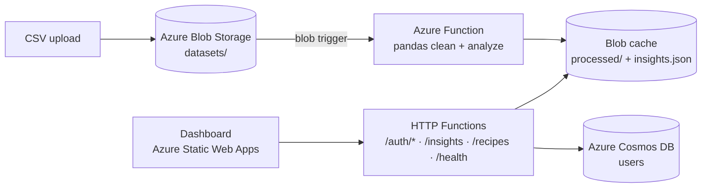

# Diet Insights: Serverless Data Pipeline on Azure

A serverless Python app on Azure. Uploading a recipe-nutrition dataset to Blob Storage automatically triggers cleaning and analysis. Authenticated users then view the cached insights on a dashboard.

## Architecture


## Highlights
- **Event-driven processing:** a blob trigger runs a pandas ETL step that validates required columns, coerces types and fills gaps. It then computes average macros by diet, top-protein recipes, cuisine counts and macro correlations.
- **Read-from-cache API:** `/insights` serves precomputed JSON from Blob Storage instead of reprocessing on every request
- **Authentication:** email/password sign-up with bcrypt hashing, JWT sessions and Google Sign-In (OAuth ID-token verification). Users are stored in Cosmos DB.
- **CI/CD:** GitHub Actions deploys the dashboard to Azure Static Web Apps on every push to `main`
- **Config via environment variables:** no secrets in the repo (`local.settings.example.json` provided)

## Tech stack
Python · Azure Functions (v2 programming model) · Azure Blob Storage · Azure Cosmos DB · pandas · JWT · bcrypt · Google OAuth · Azure Static Web Apps · GitHub Actions

## Run locally
```bash
pip install -r requirements.txt
cp local.settings.example.json local.settings.json   # add storage + Cosmos connection strings, JWT_SECRET
func start
```
